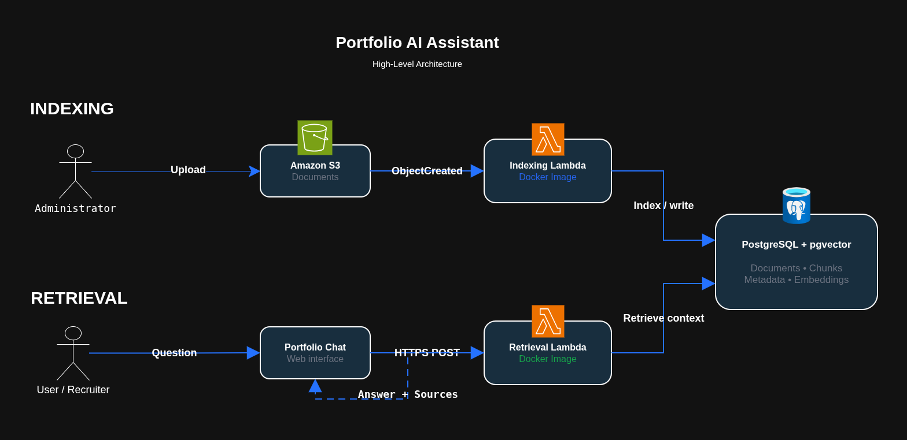
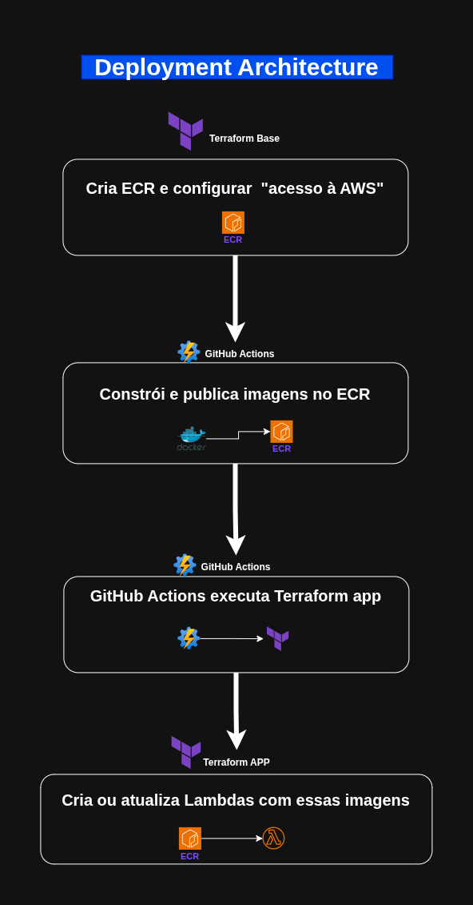

# Portfolio AI Assistant

Assistente RAG para consultar minha experiência profissional, projetos e decisões
técnicas por meio de um chat integrado ao portfólio. As respostas deverão utilizar
documentos públicos selecionados, apresentar fontes e reconhecer quando não houver
evidência suficiente.

**Em desenvolvimento.** O repositório contém handlers mínimos e definições Terraform
para duas Lambdas configuradas com imagens Docker por digest. Os Dockerfiles estão
implementados; o build e a invocação local dos handlers foram validados.
O deploy na AWS está funcionando: as duas Lambdas estão implantadas e foram
testadas, retornando mensagens fixas dos handlers então implantados. Essa validação foi
confirmada pelo mantenedor em 12/10/2026. O pipeline RAG ainda está pendente;
a operação validada corresponde às funções mínimas no ambiente dev, sem chat
integrado ou respostas geradas por IA.

No código local, a primeira etapa de indexing já está implementada: validação
e interpretação de eventos S3, com cinco testes pytest aprovados. O deploy
dessa nova etapa ainda não foi confirmado.

## Problema e objetivo

Informações profissionais estão distribuídas entre portfólio, currículo e
documentação de projetos. O assistente permitirá que visitantes e recrutadores
encontrem informações específicas sem precisar navegar por todas essas fontes.

Exemplos de perguntas:

- Qual experiência com AWS está documentada?
- Em quais projetos foram utilizadas filas?
- Por que determinada solução arquitetural foi escolhida?
- Qual projeto demonstra integração com LLMs?

O objetivo é construir e operar uma aplicação pequena, avaliar a qualidade da
recuperação e evoluir a partir de resultados medidos. O sistema não deverá inventar
experiência profissional nem executar ações externas em nome do visitante.

## Arquitetura alvo



[Abrir o diagrama em tamanho original](docs/diagrams/01-high-level-architecture.png).

O diagrama representa os dois fluxos principais planejados. As chamadas às APIs de
embeddings e geração, a Function URL, o ECR e os componentes de operação estão
descritos abaixo, mas não aparecem individualmente nesta visão de alto nível.

### Indexação

```text
Administrador → documentos aprovados em bucket S3 privado
→ evento ObjectCreated → Lambda de indexação
→ leitura e normalização → chunking + metadata
→ API de embeddings → PostgreSQL + pgvector
```

A indexação deverá preservar a origem dos trechos e registrar hash, versão e
configuração dos embeddings. Documentos alterados serão reprocessados, com
substituição atômica dos chunks após a geração dos novos embeddings.

O bucket não será público. Somente conteúdo autorizado para respostas públicas
deverá entrar na base. O mecanismo de aprovação ainda será implementado.

### Consulta

```text
Visitante → chat do portfólio → HTTPS / Lambda Function URL
→ validação → embedding da pergunta → busca no pgvector
→ seleção de contexto → API de LLM → resposta com fontes
```

A Lambda de consulta coordenará retrieval e geração. Documentos e perguntas
deverão usar a mesma configuração de embeddings. Sem evidência suficiente, o
assistente deverá informar a limitação; falhas técnicas terão tratamento próprio.

A busca inicial planejada é exata, por distância de cosseno. Chunking, Top-K e
eventuais thresholds serão avaliados com perguntas e evidências conhecidas.
Similaridade não será interpretada como garantia de verdade.

### Infraestrutura prevista

- Duas Lambdas independentes, com imagens Docker armazenadas no Amazon ECR.
- S3 para documentos e notificação de criação de objetos para a indexação.
- Function URL para consultas do portfólio; indexação sem endpoint público.
- PostgreSQL + pgvector; Neon permanece como candidato de hospedagem.
- Terraform para recursos AWS e roles IAM separadas.
- CloudWatch para logs e métricas.
- GitHub Actions implementado para validação, build, publicação e deploy.

Provedores/modelos de embeddings e geração ainda serão escolhidos.

## Estado atual do repositório

| Componente | Situação no código |
| --- | --- |
| Terraform | Separado em base/app, com estados distintos no backend S3 |
| Lambdas | Duas funções implantadas na AWS e testadas com mensagens fixas; imagens Docker por digest e arquitetura x86_64 |
| IAM | Roles separadas para Lambda com permissões de escrita nos grupos CloudWatch |
| CloudWatch | Dois grupos de logs com retenção de 30 dias |
| Handlers | Indexing valida eventos S3 e extrai os objetos; retrieval retorna mensagem fixa; não executam RAG |
| Entrada S3 | Validação e extração de bucket, chave decodificada, versão e sequencer implementadas; leitura do documento pendente |
| Dockerfiles | Imagens Python 3.14 com handlers mínimos; invocação validada localmente e nas Lambdas implantadas na AWS |
| ECR | Dois repositórios definidos em base; criação na AWS confirmada |
| GitHub/AWS | Integração OIDC e permissões para publicação e deploy implementadas; deploy na AWS confirmado pelo mantenedor |
| GitHub Actions | Workflow de build, teste dos containers, publicação, plan e apply implementado; deploy funcionando na AWS; configuração de required reviewers não documentada como validada |
| S3 de documentos e notificação | Upload → Lambda confirmado pelo mantenedor com log real; permissão de leitura definida, mas leitura do objeto ainda não implementada |
| Function URL | Ainda não definida no Terraform |
| Embeddings, retrieval, geração e persistência | Módulos reservados |
| Testes | Quatro testes Terraform com AWS simulado para bucket e integração S3, além do teste de invocação dos containers; cinco testes unitários pytest da interpretação do evento S3 |
| Scripts de invocação | Indexing local com evento JSON implementado; retrieval pendente |

O backend S3 do Terraform armazena **estado da infraestrutura**. Ele é distinto
do bucket de documentos do RAG.

## Organização do código

```text
portfolio-ai-assistant/
├── src/
│   ├── interfaces/
│   │   ├── s3_event_parser.py  # Validação e interpretação do evento S3
│   │   └── lambda_handlers/
│   │       ├── indexing.py
│   │       └── retrieval.py
│   ├── ingestion/          # Leitura e chunking
│   ├── embeddings/         # Vetorização de documentos e perguntas
│   ├── retrieval/          # Busca e seleção de contexto
│   ├── generation/         # Respostas fundamentadas
│   └── persistence/        # Operações PostgreSQL + pgvector
├── tests/
│   ├── unit/              # Testes da entrada S3 e pastas por módulo
│   └── events/            # Exemplos S3 e HTTP
├── scripts/               # Invocação das funções
├── docker/                # Dockerfiles de indexação e consulta
├── terraform/
│   ├── base/              # ECR, OIDC e permissões do GitHub Actions
│   └── app/               # Lambdas e recursos da aplicação
├── docs/                 # Documentação, diagramas e rascunhos pessoais
├── requirements.txt
├── pytest.ini
├── Makefile               # Reservado para testes e tarefas futuras
└── README.md
```

A organização separa interfaces de entrada, processamento e persistência. Os
handlers deverão traduzir eventos e chamar serviços; clientes externos serão
injetados quando necessário para permitir testes sem AWS ou chamadas pagas.

As imagens usam os handlers `interfaces/lambda_handlers/indexing.py` e
`interfaces/lambda_handlers/retrieval.py`. Indexing recebe eventos S3; retrieval
será a entrada de consulta HTTP. O processamento dos documentos ainda será
implementado no fluxo de indexing.

### Primeira etapa de indexing

O handler chama `interfaces/s3_event_parser.py`, que:

- Exige uma lista `Records` não vazia.
- Valida a origem `aws:s3` e eventos `ObjectCreated:*`.
- Extrai bucket, chave decodificada, `versionId` e `sequencer` de cada registro.
- Aceita múltiplos registros e preserva os campos opcionais quando presentes.
- Rejeita eventos inválidos com `ValueError`, registrado e propagado pelo handler.

O retorno contém `statusCode`, uma mensagem em inglês e a lista `objects`.
Isso confirma a validação do evento, não a indexação do documento. Ainda não há
chamadas ao S3, geração de embeddings ou persistência. O parser pertence a
`interfaces/` por interpretar o formato externo; a leitura ficará em `ingestion/`.

Os rascunhos pessoais de implementação estão em
[docs/rascunho-indexing.txt](docs/rascunho-indexing.txt) e
[docs/rascunho-retrieval.txt](docs/rascunho-retrieval.txt).

## Desenvolvimento local

Criar e ativar um ambiente virtual e instalar as dependências declaradas:

```bash
python3 -m venv .venv
source .venv/bin/activate
python -m pip install -r requirements.txt
```

Ainda não há dependências de runtime para os provedores de modelos ou banco.
O `Makefile` está reservado para testes e outras tarefas futuras; não possui
comandos implementados.

Para executar os testes unitários, instale pytest no ambiente virtual:

```bash
python -m pip install 'pytest>=8.3,<10'
python -m pytest
```

Para executar somente os testes da entrada S3:

```bash
python -m pytest tests/unit/test_s3_event.py -v
```

Os JSONs em `tests/events/` são fixtures; o de indexing reproduz um evento real.

O evento de consulta representa o envelope entregue pela Function URL. Em uma
requisição HTTP real, o cliente enviará apenas o JSON da pergunta presente em
`body`, não o envelope inteiro.

Para invocar o handler de indexing diretamente no Python local:

```bash
python3 scripts/invoke_indexing.py
```

O script usa `tests/events/indexing/s3_object_created.json`; edite esse JSON
para testar outro evento.
O contexto é `None`. Este comando não invoca a Lambda na AWS nem usa Docker;
executa o handler Python atual, que valida o evento e retorna os dados dos
objetos, sem ler documentos no S3. Quando integrações externas forem adicionadas
ao handler, elas também serão executadas pela invocação local.

Para depurar no VS Code, selecione o interpretador da `.venv` com
**Python: Select Interpreter**. Na configuração de execução local do
`launch.json`, use `scripts/invoke_indexing.py` como programa. Coloque um
breakpoint no handler e inicie a depuração com **F5**. A configuração do VS Code
é local; a invocação pelo terminal acima também funciona sem ela.

## Terraform e deploy

As configurações em `terraform/base/providers.tf` e
`terraform/app/providers.tf` referenciam o mesmo bucket S3 de estado, com chaves
distintas. Para utilizá-las em outra conta, revisar backend, região,
credenciais externas e nomes antes de inicializar.

### Retenção de imagens no ECR

O `base` configura uma política de lifecycle em cada repositório (`indexing` e
`retrieval`) para manter somente as três imagens mais recentes por data de push,
incluindo imagens com ou sem tags. Após aplicar a política, o ECR remove as
imagens excedentes automaticamente; a limpeza pode levar até 24 horas.
A retenção considera pushes, não deploys bem-sucedidos: uma imagem em uso pela
Lambda ou necessária para rollback pode ser removida se ficar fora das três
mais recentes.

### Bucket de documentos

O `base` cria o bucket `${project_name}-documents-${account_id}-${aws_region}`,
com bloqueio de acesso público, ACLs desabilitadas, criptografia SSE-S3 e
versionamento. `force_destroy = false` e `prevent_destroy = true` protegem os
documentos contra remoção pelo Terraform.

Execute e revise o `plan` de `base` e aplique-o antes do deploy de `app`.
Isso cria o bucket e atualiza as permissões da role de deploy. Os dois estados
precisam usar os mesmos `project_name`, conta AWS e `aws_region`.
O nome pode ser consultado com `terraform -chdir=terraform/base output documents_bucket_name`.

O `app` gerencia exclusivamente a configuração de notificações do bucket e a
permissão para o S3 invocar a Lambda de indexing. Uploads sob `documents/`
disparam `s3:ObjectCreated:*`, inclusive uploads multipart. O prefixo é
configurável por `documents_prefix`; a role da Lambda só pode ler objetos e
versões sob esse prefixo. Uploads fora dele não disparam indexing.

O handler de indexing no código local valida o evento e extrai os dados dos
objetos, mas não lê os documentos. O pipeline
ainda precisa ser implementado, com tratamento de eventos duplicados e fora de
ordem e leitura da versão indicada no evento. Exclusões não disparam eventos
nesta configuração. Nenhum arquivo é enviado pelo Terraform.

### Deployment Workflow



[Abrir o fluxo de deploy em tamanho original](docs/diagrams/02-deployment-architecture.png).

O diagrama representa o fluxo de deploy implementado:

1. Terraform `base`, executado inicialmente na máquina local, cria o ECR e
   configura o acesso do GitHub à AWS via OIDC. O provider OIDC existente é
   reutilizado. A base volta a ser aplicada quando seus recursos mudam.
2. Um push na branch `main` dispara o GitHub Actions, que executa os
   testes Terraform e a invocação local dos containers, constrói as duas imagens
   Docker e publica-as no ECR. Os testes pytest ainda são executados localmente.
3. No mesmo pipeline, o Actions passa as URIs com os digests das imagens ao
   Terraform `app`, executa o plan e aplica o plano no environment dev. A espera
   por aprovação depende da configuração de required reviewers.
4. Terraform `app` cria ou atualiza as Lambdas com as imagens publicadas e
   gerencia suas roles IAM e grupos de logs.

O digest identifica o conteúdo de uma imagem, permitindo selecionar sua versão
exata. Publicar uma imagem no ECR, sozinho, não atualiza a Lambda.
GitHub Actions coordena o deploy; Terraform gerencia a configuração das funções.

Terraform `app` recebe imagens por digest. O workflow está implementado em
`.github/workflows/deploy.yml` e utiliza o ambiente dev. A aprovação depende da
configuração de required reviewers no GitHub; a declaração do environment no
YAML, sozinha, não exige aprovação.

Veja [como preparar e executar o deploy](docs/deployment.md).
O deploy e a invocação das Lambdas na AWS foram confirmados pelo mantenedor
em 12/10/2026, com retorno das mensagens fixas esperadas. Os procedimentos de
rollback e a verificação automatizada das funções após o deploy ainda estão
pendentes. Essa confirmação não abrange o pipeline RAG nem a integração do chat,
que ainda serão implementados.

## Segurança e operação

Antes de disponibilizar o chat publicamente, implementar:

- Seleção explícita de fontes, sem credenciais ou dados confidenciais.
- Secrets externos ao código, às imagens e ao contexto do modelo.
- Permissões mínimas e distintas para indexação e consulta.
- Limites de entrada, contexto, saída, duração e consumo.
- Tratamento de erros e logs estruturados sem exposição desnecessária de conteúdo.
- Validação das citações e renderização segura no frontend.
- Testes de prompt injection direta e indireta.

Conteúdo recuperado deve ser tratado como dado, não como instrução. Prompts
restritivos e citações não eliminam alucinações ou prompt injection.
As exclusões do Git e do contexto Docker não substituem a revisão dos arquivos
antes de publicá-los.

## Avaliação e próximos passos

1. Verificar a configuração de aprovação no environment dev e aplicar a base quando seus recursos mudarem.
2. Adicionar verificação automatizada das Lambdas na AWS após o deploy e documentar rollback.
3. Selecionar poucos documentos e anotar perguntas com evidências esperadas.
4. Implementar leitura, chunking, embeddings e persistência com testes.
5. Implementar a leitura S3 no indexing e validar atualização/exclusão de documentos.
6. Implementar consulta, Function URL e integração com o portfólio.
7. Avaliar retrieval separadamente da geração.
8. Medir latência, erros, tokens e custos antes de otimizar.

Implementação, testes locais, publicação e operação serão registrados como etapas
distintas. Não há métricas de uso ou incidentes de produção documentados.
